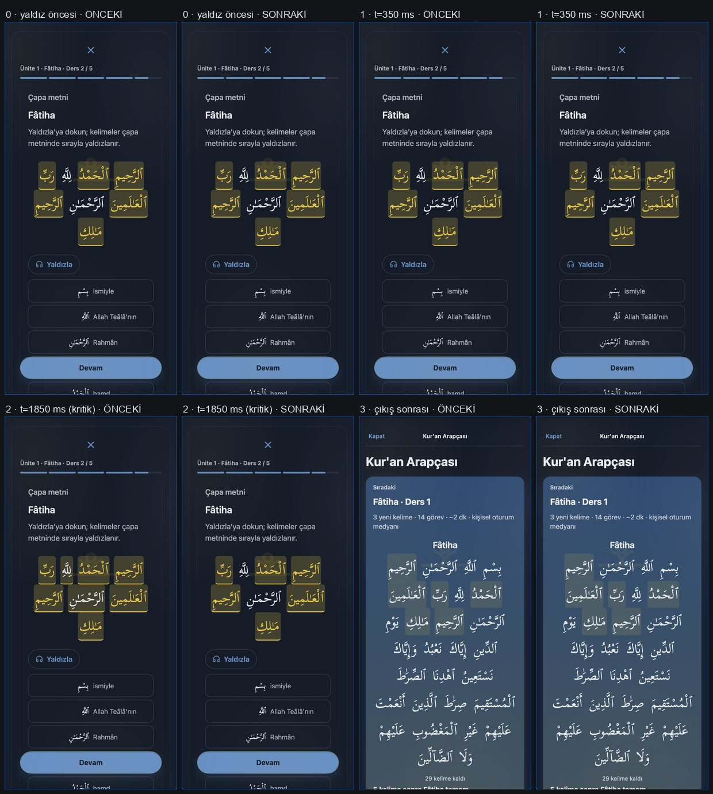
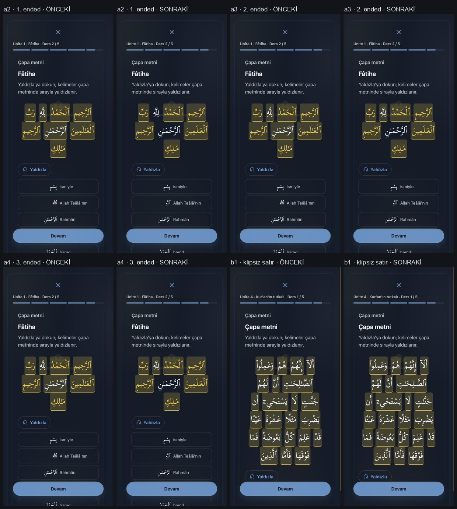

# K3PD güncel durum

- Program aktif. K3PD-14 done/ACCEPTED_DEVIATION; nextPrompt=K3PD-15. Kapanış kullanıcı talimatına dayalıdır; bağımsız denetim yapılmamıştır ve PASS olarak sunulmaz.
- Yalnız K3PD-14 A adayı 613a19c087e5311d0ecd324caaf470bbada065f7 için releaseApproval=APPROVED ve tam 11 exact yol kapsamı kaydedilmiştir. K3PD programı genel released durumuna geçirilmemiştir.
- GitHub Pages workflow run [39616251782](https://github.com/mustafaras/s/actions/runs/39616251782): validate=success, deploy=success; uzak main SHA adayla eşit. Statik URL no-cache denetimi 68/68 SHA-256 eşliği, 0 eksik ve 0 hata verdi; dört ana giriş/çalışma zamanı varlığı ayrıca eşleşti.
- Son G0/G1: hedef kart testleri, kontrol kapısı ve ortak KAO regresyonları exit 0; pin freshness 63/63 taze, 0 ertelenmiş; performans 184.591 KiB içerik, 137.186/137.25 KiB runtime, 15.922 KiB CSS, p95 8.964 ms ve steady 3.707 ms. Baseline yazılmadı; slow-host istisnası kullanılmadı.
- Paylaşılan quranLearn.js farkı K3PD-13 commit’inden temiz ayrılmıştır. KAPANIS, README, GORSEL-KANIT.md ve PDF başlangıç hashleri aynı kaldı ve yayına alınmadı. Eski K3P 37/37/tarihsel onay K3PD onayı değildir.
- Cihaz, ekran okuyucu, L2, 230 kayıt ve öğrenme etkisi kapıları kullanıcı tarafında pending; K3PD-11/K3PD-29 görsel kabulü de ayrı pending kalır. K3PD-15 yalnız sıradaki adaydır; başlatılmadı.

Kanıt: [K3PD-14/EVIDENCE.md](kanit/K3PD-14/EVIDENCE.md).

Sıradaki aday: K3PD-15 (yalnız aday; bu oturumda başlatılmadı).

## K3PD-09 — bağımsız PASS ile kapandı

- Başlangıç HEAD `10914697204b8411beae040ff108d2c80caa0a7d`; dal `k3pd-denetim-duzeltmeleri`; başlangıç `HEAD...origin/main` 3/0. Başlangıçtaki üç korunan kirli dosya kapsam ve stage dışında kaldı.
- Kullanıcı izniyle yalnız PROMPTLAR.md’deki K3PD-09 allowlist satırı exact yollara çevrildi; K3PD-08 satırı değişmedi. Kartın exact kapsamı sekiz yol ile sınırlı.
- Eski HEAD kaynaklı VM replay’i DDA’da beş beklenen kusuru kırmızı yaptı. Güncel gerçek handler/UI çıktısı: iki yanlış sonrası normal MC 3 seçenek/3 düğme; kolay görev 2/2; sunulmuş yardım sonrası pencere veya streak değişse de doğru grade 2; yardımsız normal hızlı doğru grade 4. Undo, helper tekilleştirme ve restart temizliği geçti. Ladder build 5 çip/5 düğme kaldı.
- Bağımsız salt-okur denetçi kaynak, davranış, exact diff, state/log, hash, handler/schema/migration/pin sınırlarını inceledi ve `PASS` verdi. DDA 14, FSRS 24 vektör, queue 20 görev + 1000 interleave, resume 7 kontrol ve G0/G1 denetimi geçti.
- Perf kayıtları birlikte korunuyor: uygulayıcı varsayılanı göreli +25% bandını 8.572 ms ile 6.36 ms sınırında aştı; yavaş-host istisnası yalnız göreli bant içindi (runtime 135.996 KiB, CSS 15.877 KiB, content 184.591 KiB, p95 22.493 ms, steady 3.493 ms; mutlak 40 ms tavanı geçti). Denetçi izole varsayılanı geçti (p95 9.488 ms, steady 5.419 ms); flag’li tekrar p95 11.308 ms, steady 6.688 ms. `KAO2_WRITE_BASELINE` unset; baseline SHA-256 `302cfcc85422c346a62fb2e9b62df8a9f64c8ec362099adc5d40a35bce29d384` değişmedi.
- `App.kao*` 45; schema/migrate, FSRS parametreleri, A/B hash, içerik, pin ve kapsam dışı runtime dosyaları değişmedi. Korunan üç dosyanın başlangıç hash’i aynı. K3PD release approval `NOT_APPROVED`; eski K3P 37/37 kaydı ayrı.
- DURUM/KAYIT/EVIDENCE `done/PASS` ile eşlendi. Sıradaki `K3PD-10` yalnız adaydır; bu kart ona yetki vermez. Push/merge/tag/deploy veya görsel çekimi yapılmadı.

Sıradaki aday: K3PD-10 (bu PASS uygulama izni değildir; bu oturum burada durur).

K3PD-01 kapandı; onun PASS’i K3PD-02’ye çalışma izni değildi. Kullanıcının bu oturumdaki “sen karar ver devam et” yanıtı K3PD-02 için karar seçimini asistana devretti; asistan A’yı seçti, kullanıcıya doğrudan A atfedilmedi. K3PD-02 bağımsız salt-okur `PASS` ile yalnız karar/sözleşme kapsamı için kapandı. H4 runtime sayaç düzeltmesi, yeni ölçüm/cohort, cihaz/L2 kabulü ve yayın yapılmadı. Sonraki karta yetki verilmedi. Yeni yayın onayı `NOT_APPROVED`; K3PD-32 adayı ve ona özgü açık onay ile K3PD-33 olmadan push/merge/deploy yapılmaz.

## K3PD-02 — H4 karar ve ölçüm sözleşmesi

- Kullanıcı yanıtı (aynen, 2026-10-18): “sen karar ver devam et”. Bu, seçimi asistana devreden gerçek yanıttır; A seçeneği kullanıcının doğrudan seçimi olarak yazılmıyor.
- Asistanın bu yetkiyle seçtiği karar: **A — `daily.calib.s21={n, ok}` alanını koru; yeni kalıcı alan ve migration yok.** Eski sayaçlar düzeltilemeyeceği için yalnız kesim sonrası geçerli cohort ölçülür. Gerekçe: ikinci bir kalıcı sayaç ailesi ve migration yükü eklemeden mevcut alanı yeniden kullanmak; geçmişteki yanlış sayıları tarihsel gerçek gibi sunmamak.
- Alternatif B’nin tam şema etkisi: isteğe bağlı `quranLearn.daily[YYYY-MM-DD].calib.s21v2={n: nonnegative integer, ok: nonnegative integer, ok<=n}`. Alan ilk uygun yanıtta oluşturulur; geriye dönük doldurulmaz, eski `s21` değiştirilmez, v2 yokluğu sıfır geçerli gözlem sayılır ve rapor yalnız v2’yi okur. B seçilmedi; migration veya alan yaratma yetkisi yok.
- Uygunluk, cevap öncesi dondurulmuş kart durumu ile alınır: `s>=21`, orphan yok, `readerUnknown` yok. Cevap sonrası scheduled.s kullanılmaz. Yalnız Latin okunuşun o görevde gerçekten mevcut fakat kapalı kaldığı sunum uygundur.
- **folded:** okunuş desteği var, native disclosure kapalı ve cevap anına dek Latin görünür metinde ya da erişilebilir ad/ARIA bilgisinde açığa çıkmıyor. Uygun ve kabul edilmiş ilk cevapta `n` bir artar; doğru cevapta `ok` da bir artar, yanlış cevapta `ok` değişmez. Örnek: cevap öncesi `s=21`, kapalı okunuşlu cloze ve yanlış cevap → `n+1, ok+0`; aynı görevde doğru cevap → `n+1, ok+1`.
- **shown:** kullanıcı/klavye/ekran okuyucu native `
`’ı açtı veya Latin okunuş ARIA/erişilebilir adla cevap öncesi sunuldu. Bu görev gizli destek kohortunun payına/paydasına girmez. Açılma yalnız `ui` içinde tutulur; kalıcı alana yazılmaz.
- **disabled:** `settings.translit=false` nedeniyle Latin metni hiç sunulmuyor; bu folded koşulu değildir ve H4 pay/paydasından çıkarılır.
- **build:** K3P-19 seq53’teki gibi seçim çiplerinin Latin okunuşları durable kartlarda başlangıçta katlıdır. Ancak build her ara seçimi `pending` tutar; seçilen harf `kao-order-target` içine `kaoArabicPairHTML` folded argümanı olmadan çizilir ve Latin okunuş final yanıttan önce görünür. Bu yüzden build H4’e girmez; “seçim çipleri katlı” bilgisi build hedefindeki bu açığa çıkmayı iptal etmez.
- **cloze:** uyarıcı `pronunciationFolded=true` ile katlı çizilir; şıklar görev kartının durable/folded durumunu izler. Yalnız tüm ilgili yüzeyler cevap anına dek folded kalır ve seçenek/ARIA okunuşu sızdırmazsa girer; açılma veya sızıntı olursa shown sayılıp dışarıda kalır.
- Uygunluk ve “bu görevde açıldı mı” bilgisi görev başında dondurulur. Yeniden çizim ikisini sıfırlamaz veya cevap sonrası s ile yeniden hesaplamaz. Aynı aktif task ID için tekrarlanan cevap olayı idempotenttir. Undo, önceki günlük `n/ok` anlık görüntüsünü geri yükler; açılmış olma bilgisi aynı görev için korunur; yeniden cevaplama en fazla bir yeni gözlem yazar.
- H4 = `100 * ok / n`; `n` yalnız uygun folded görevlerin ilk kabul edilmiş cevaplarıdır ve doğru+yanlış cevapları içerir; `ok` bunların doğru altkümesidir. Hedef `>=85%`. Build, shown, disabled, orphan, readerUnknown ve cevap öncesi `s<21` görevleri paya/paydaya girmez.
- **Kesim:** `R`, bu sayaç düzeltmesinin gerçekten üretime çıktığı UTC takvim günüdür. R günü tamamen geçiş/legacy sayılır; aynı günde eski ve yeni sayaç karıştırılmaz. İlk yeni cohort günü kesin olarak `R+1 00:00Z`’de başlar. R henüz gerçekleşmedi ve K3PD yayın onayı `NOT_APPROVED`; bu yüzden burada takvim tarihi uydurulmaz. R öncesi günler raporda `LEGACY_INVALID` görünür; geçmiş silinmez, temizlenmez, backfill edilmez.
- Bu kart yalnız sözleşme/karar kaydıdır. H4 davranışını düzeltmez ve gerçek ölçüm PASS’i üretmez. Uygulama, regresyon ve rapor değişiklikleri K3PD-03 veya sonraki açık karta aittir; L2/cihaz kabulü ayrı kalır.

K3PD-02 karar kaydı ve bağımsız denetim tamamlanınca sıradaki aday K3PD-03’tür; bu bilgi tek başına çalışma izni değildir.

Sıradaki aday: K3PD-03 (bu PASS tek başına uygulama izni değildir).

## K3PD-03 — KART KAPANDI

- Başlangıç HEAD `6b393f35849b6ce524174a94a37ad49558d2d644`; dal `k3pd-denetim-duzeltmeleri`; `HEAD...origin/main` farkı 3/0.
- Runtime ve deney raporu düzeltmeleri, negatif sınamalar ve G0/G1 regresyonları geçti. H4 runtime testi 13 kontrol; deney raporu testi 7 hipotez, R+1 cohort sınırı, sızıntı 0, elle hesap 7/7 ve 7 hata yolu. Ölçüler `kanit/K3PD-03/EVIDENCE.md` içinde.
- Rapor aracına ayrı `--h4-baslangic YYYY-AA-GG` eklendi. H4 yalnız bu R+1 başlangıcından `--bugun` tarihine kadar hesaplanır; başlangıç yoksa H4 yüzdesi ve legacy toplamı çıkmaz, cohort'ta veri yoksa `0%` verilmez. `--kesim` H2/H7 içindir ve H4'ten bağımsızdır. `--ornek` sentetik cohort başlangıcını rapor başlığında belirtir.
- Önceki bağımsız `PARTIAL` bulgusunu yakalayan sentetik eski 9/10 + yeni 1/2 vakası, eski kodda hatalı `%83,3 (10/12)` verdi ve test exit 1 oldu; düzeltmede yalnız R+1 `%50,0 (1/2)` verildi, legacy `n=10` ayrıca gösterildi. Bugünden sonraki 4/4 satırı dışlandı.
- Kullanıcının aynı kartta rapor kaynağını ekleme onayıyla K3PD-03 allowlist'i `kao3-premium/araclar/deney-rapor.cjs` dahil 10 exact path içeriyor. Seq31 bağımsız denetimi gecikmiş eski `
` toggle olayının aynı ID’li yeni görevi yanlış `opened` işaretleyebildiğini buldu; sentetik negatif exit 1. Olay artık etkin task nesnesi, root ve bağlı disclosure düğümüyle eşleştiriliyor; yeni regresyon exit 0. Kart done/PASS; bağımsız seq33 denetimi tamamlandı.
- Gerçek `R` yayın tarihi/kullanıcı kohortu yok; canlı yedekte `--h4-baslangic` verilmedikçe H4 ölçümü kapalıdır. Sentetik Node/VM kanıtı gerçek browser/cihaz, ekran okuyucu veya L2 kabulü değildir.
- Korunan kirli `KAPANIS.md`, `README.md` ve `kanit/sonraki/GORSEL-KANIT.md` başlangıç hashleriyle aynı ve karta dahil değil. Eski K3P state/ledger/pinler değişmedi; `App.kao*` sayısı 45.
- Bağımsız denetim PASS ve K3PD-03 kapalıdır. Sıradaki aday K3PD-04; bu aday otomatik uygulama izni değildir. Burada dur. Push, merge veya deploy yapılmaz.

Sıradaki aday: K3PD-04 (bu PASS tek başına uygulama izni değildir).

## K3PD-04 — bağımsız PASS ile kapandı

- Kullanıcı kararı: A — Bütçeye göre böl. Exact allowlist dört yolla sınırlı; PROMPTLAR öz-düzeltmesi yalnız bu satıra ait.
- Bağımsız denetim: PASS. Seq35 append-only korundu; seq36 hatalı yer tutucu makbuzları ve gerçek komut tekrarlarını açıkça kaydetti.
- Bütçe: 5/10/15 dakika ve 6/30/60 saniye görev sürelerinde kapasite 50/100/150, 10/20/30, 5/10/15; 13 çekirdek görev 78/390/780 saniye.
- Kapanış sonrası doğrulamalar exit 0: durum kapısı (34 kart, nextPrompt K3PD-05), K3PD regresyonu (33 negatif + 34 K3PD + 6 legacy pin), eski K3P senkronu (37/37, null), production diff, whitespace ve 3 korunan hash.
- Durum: K3PD-04 done/PASS; sıradaki aday K3PD-05. Bu aday için kullanıcı promptu olmadan çalışma başlamaz.
- Sınırlar: üretim değişikliği 0. Cihaz, ekran okuyucu, L2 ve yayın kabulü bu kartta ölçülmedi.

Sıradaki aday: K3PD-05 (uygulama izni değildir).

## K3PD-05 — bağımsız PASS ile kapandı

- Başlangıç HEAD `cdf30ba83c9e08f044fb3761fab17c1ecf84f4e3`; dal `k3pd-denetim-duzeltmeleri`; başlangıç `HEAD...origin/main` 5/0.
- Süre tahmini cap ile kırpılmıyor: 13×30 sn=7 dk, 13×60 sn=13 dk; 24×6 sn=3 dk. Kaynak sırası oturum medyanı → açık etiketli 7 günlük yedek → açık etiketli 30 sn varsayılanı.
- Son 50 geçerli doğru+yanlış yanıtın medyanı yalnız UI oturumunda tutuluyor; tek ekleme noktası var. Yeni regular/lesson/mastery/repair oturumları geçmişi sıfırlar; etkin oturum resume’u korur. Yeni kalıcı alan, migration, şema veya `App.kao*` handler yok; adet 45.
- V/K/K/T, ilgili G2, G0+G1, sentetik regresyonlar ve bağımsız salt-okur denetim PASS. Korunan üç kirli dosya hashleri aynı kaldı ve karta/stage’e girmedi; eski K3P 37/37 / `nextPrompt=null` ayrı.
- Perf: geçerli sessiz-host p95 PASS 15.393 ms (≤40), steady 8.754 ms; baseline yazılmadı. Daha sonraki yoğun-host denemeleri 67.703 ve 41.043 ms ile başarısız oldu ve EVIDENCE/KAYIT’ta açıkça duruyor; eşik gevşetilmedi. 120 sn K2F-31 ölçüm tavanı korunmuş, üstündeki yanıtlar için medyanın doygunlaşma sınırı açık.
- Kullanıcının ayrı yönetici onayıyla canlı yayın engelleri düzeltildi: KAO/SW pinleri `20261019a`, sürüm fixture’ı eşlendi; Pages paketi `kao3-premium` plan/state dizinini dışlıyor ve staging guard bunu doğruluyor. Pages run `39253191803` / deploy commit `6ca8946a21dcba73b93603d71a651871a4def34a` success; canlı no-cache SHA-256 eşliği index, sw.js ve iki KAO modülünde geçti, K3PD DURUM.json public URL’si 404. Bu tek kart yayın izni, program geneli `releaseApproval=NOT_APPROVED` değerini veya K3PD-06 yetkisini değiştirmez.
- Kart `done/PASS`; state ve KAYIT son kayıtla eşleşiyor. Sıradaki aday K3PD-06’dır; bu aday çalışma izni değildir.

Sıradaki aday: K3PD-06 (bu PASS tek başına uygulama izni değildir).

## K3PD-06 — bağımsız PASS ile kapandı

- Başlangıç HEAD `27620d4fae1ef6c09f04ff54e33d0ed238be73eb`; branch `k3pd-denetim-duzeltmeleri`; `HEAD...origin/main` `0/0`.
- K3PD-04’te onaylanan A zaman bütçesi uygulanıyor: gerçek görev maliyetine göre ardışık parçalar, aynı çözülmemiş göreve resume ve görünür süre aşımı seçeneği. `quranLearn.js` mevcut `onboarding.minutes` alanına ve handler’ına bağlandı; yeni kalıcı alan, schema/migration veya App.kao* handler yok.
- K3PD-04’te onaylanan A kararı uygulanıyor. Gerçek maliyete göre parçalar hesaplanıyor; tam due kuyruğu warmup ve artan R sırasından geçiriliyor, mevcut en çok 20 review plan sınırı korunuyor. Parça sonu aynı çözülmemiş göreve döner; bütçe üstü devam görünür ve açık seçim ister.
- Önceki bağımsız denetimin seq48 `PARTIAL` bulgusu, 20+ due kartın tamamını Flow’a verip en düşük-R adayları plan sınırına kadar sıralayarak giderildi. Sentetik gerçek başlatıcı testi 60 due kartı (ilk 20 yüksek R, sonraki 40 daha düşük R) kuruyor; `test_k3p_budget.js` 11/11, `test_k3p_rhythm.js` 5/5 PASS.
- Tam G0+G1+G2 yeniden koşusu exit 0. İzole `KAO2_WRITE_BASELINE` kapalı perf: runtime `135.569 KiB`, CSS `15.877 KiB`, content `184.591 KiB`, p95 `6.317 ms`; A-9 `KAO2_EVIDENCE_OUT` kapalıyken `219/219` dosya exit 0, iç A-10 p95 `5.315 ms`.
- `App.kao*` sayısı 45. Pin freshness `61 fresh / 2 deferred / 0 blocking stale`; iki erteleme yalnız K3PD dalındaki izinli quranLearn çalışma ağacı değişikliklerine ait. `index.html`, `sw.js`, schema/migration ve üretim pinlerinde diff yok; üç korunan kirli dosyanın hash’i başlangıçla aynı ve kapsam/stage dışında.
- Çeldirici testinde 2,203 sentetik görev ve sıfır yinelenen seçenek PASS. Tarihsel sıra karşılaştırma tabanı mevcut değil; bu alt kanıt `UNVERIFIABLE`, PASS olarak sunulmuyor.
- Taze bağımsız salt-okur denetim `PASS` verdi. Denetçi 60-aday gerçek başlatıcı negatifini ve 11/11 sınamayı, resume/ödül, dakika ayarı ve açık overrun yollarını; G0+G1+G2 ve bağımsız A-9 `219/219` koşusunu yeniden doğruladı.
- Bağımsız A-10 ölçümü: runtime `135.569 KiB`, CSS `15.877 KiB`, content `184.591 KiB`, p95 `6.116 ms`. Kendi izole G1 perf koşumuz p95 `6.317 ms`; baseline yazılmadı. İki ölçüm de ≤40 ms.
- Tarihsel distractor sıralama baseline’ı bulunmadığı için o karşılaştırma `UNVERIFIABLE`; test edilen 2,203 görevde yinelenen seçenek yok. Bu K3PD-06 kabulünü engellemiyor.
- Kart `done/PASS`; kayıtlar aynı committe senkronlandı. Sıradaki aday K3PD-07’dir; bu PASS veya aday satırı uygulama izni değildir.
- Program yayın onayı `NOT_APPROVED`; K3PD-06 için push, merge, tag veya deploy yapılmıyor. Korunan üç kirli dosya stage/commit dışında kalıyor.

Sıradaki aday: K3PD-07 (bu PASS tek başına uygulama izni değildir).

Kanıt: [K3PD-06/EVIDENCE.md](kanit/K3PD-06/EVIDENCE.md).

## K3PD-07 — bağımsız PASS ile kapandı

- Başlangıç HEAD 9a0a4f7592657d8e4043d62e59507948854c26eb; dal k3pd-denetim-duzeltmeleri; başlangıç HEAD...origin/main 1/0.
- Sıkılma eşiği ve gerçek okunuş sunumu; DDA 7, pronunciation_fold 15, pronunciation contract 524/524, requirements hedefli 3.752 ms (<50 ms), build 7/7 ve cloze 7/7 ile son kaynak üzerinde doğrulandı. G0/G1 exit 0.
- İzole perf exit 0: içerik 184.591 KiB, runtime 135.809 KiB, CSS 15.877 KiB, p95 6.430 ms, steady 4.244 ms; baseline yazılmadı.
- Bağımsız salt-okur denetim PASS verdi. Eşik, ayar-kapalı DOM/ARIA, sibling disclosure, cloze ARIA, H4 UI izleyicisi, tam kapsam, 45 App.kao* ataması ve yasaklı pin/schema/migration sınırları geçti.
- Pin freshness 61 taze / 2 K3PD dalında ertelenmiş / 0 engelleyici. Korunan üç kirli dosyanın hash’i başlangıçla aynı ve stage dışında.
- Kart done/PASS; KAYIT seq60 ve state senkron. Tek mantıksal yerel commit oluşturulacak. Program releaseApproval NOT_APPROVED; push/merge/tag/deploy yapılmadı.

Sıradaki aday: K3PD-08 (bu PASS tek başına uygulama izni değildir).

Kanıt: [K3PD-07/EVIDENCE.md](kanit/K3PD-07/EVIDENCE.md).

## K3PD-08 — bağımsız PASS ile kapandı

- Başlangıç HEAD `f2d1041de315954356f85c80b3e5379e1b536b2a`; dal `k3pd-denetim-duzeltmeleri`; `HEAD...origin/main` `2/0`.
- Kullanıcının açık izniyle yalnız PROMPTLAR.md içindeki K3PD-08 allowlist satırı exact yollara çevrildi; diğer kart satırları değişmedi.
- Üç ardışık yanlışta yeniden tanış paneli, doğrulanmış `kaoIntroExample` kaynağından Arapça/okunuş/Türkçe/künye örneği çiziyor. Eksik, doğrulanmamış veya bozuk örnek için içerik uydurulmuyor; anlam yedeği korunuyor. Dinleme düğmesi yalnız mevcut `kaoAudioEnabled` izniyle görünür ve mevcut `App.kaoPlay` yolunu kullanır.
- Geri alma snapshot’ı yalnız geçici UI’de sonuç penceresi ve yanlış sayacını saklıyor; undo bunları yanıt öncesine döndürüyor. Kalıcı alan, schema/migration veya yeni App handler eklenmedi.
- Kırmızı kanıt: eski kaynakla `test_k3p_dda.js` üçüncü yanlışta beklenen doğrulanmış örnek yerine `undefined` verdi ve exit 1 oldu. Son kaynakta DDA 9 kontrol, feedback-copy, pronunciation contract 524/524 ve a11y 14 kontrol exit 0.
- G0 ve G1 koşuları tamamlandı; G1’de perf göreli taban bandı makine ölçümünde iki kez aşıldı (steady 8.289/13.029 ms; limit 6.360 ms). Planın izin verdiği `KAO2_ACCEPT_SLOW_HOST=1` koşusu exit 0: p95 19.032 ms, steady 10.306 ms; mutlak 40 ms sınırı ve boyut tavanları geçti, baseline yazılmadı. Bu göreli ölçüm istisnası görünür kalır.
- İlgili G2 lesson-flow 24/24 ve lesson-ayah 5/5 exit 0. `App.kao*` sayısı 45; 61 asset pini taze, iki önceden ertelenmiş K3PD pini aynı kaldı; şema/migration/pin/shell dosyalarında diff yok.
- Korunan üç kirli dosyanın başlangıç SHA-256 değerleri eşleşti; dosyalar karta/stage’e alınmadı.
- Bağımsız salt-okur denetim `PASS` verdi; 2/3 yanlış eşiği, doğrulanmış içerik, bozuk alan fallback’i, ses izni, undo, hedef testler, G0/G1 ve kapsam sınırları doğrulandı.
- Kart `done/PASS`; DURUM/KAYIT `nextPrompt=K3PD-09` ile eşleşiyor. K3PD-09 yalnız adaydır, uygulama izni değildir. Yayın onayı `NOT_APPROVED`; push/merge/tag/deploy yapılmadı.

Kanıt: [K3PD-08/EVIDENCE.md](kanit/K3PD-08/EVIDENCE.md).

Sıradaki aday: K3PD-09 (bu PASS uygulama izni değildir).

## K3PD-10 — bağımsız PASS ile kapandı

- İlk bağımsız FAIL’in bulgusu seq68’de korundu; boş doğrulanmış anlam için R2’ye düşüp boş başlık gösterme giderildi. Anlamsız build görevi kurulmaz, gerçek oturum/ders practice UI kuyruğuna alınmaz; FSRS ve günlük notlama değişmez.
- Bağımsız VM ölçümü: build/R3/A, tr>ar, isNew/retry korunuyor; “Anlamı: -den, -dan” görünür, harekeli/harekesiz cevap ilk HTML’de yok. 274 uygun verified lemma, eksik birincil anlam 0. Ladder A=522/1000, 32 build; B/R1 build dışı; kaygı 5 çip/5 düğme.
- Kart testleri ve bağımsız tekrarlar PASS. Bağımsız perf: p95 17.434 ms, steady 8.250 ms; KAO2_WRITE_BASELINE unset, baseline değişmedi. Yalnız göreli bant slow-host istisnası; mutlak tavanlar geçti. Tarihsel distractor-sıralama tabanı bulunmadığından yalnız eski sıralama karşılaştırması UNVERIFIABLE; K3PD-10 kabul ölçütü değil.
- App.kao* 45; schema/migrate/pin/content/FSRS/A-B sınır diff’i yok. Üç korunan kirli dosyanın hash’i aynı ve stage dışında. K3PD release NOT_APPROVED; eski K3P 37/37 ve tarihsel onayı ayrı.
- Bağımsız salt-okur denetim PASS; kart done/PASS. Yayın/push/merge/tag/deploy/görsel yok. K3PD-11 yalnız adaydır.

Kanıt: [K3PD-10/EVIDENCE.md](kanit/K3PD-10/EVIDENCE.md)

## 2026-10-20 — açık kullanıcı onayıyla A adayının yayını

- Yayımlanan aday: a6c5961dbf19a652b8bd7d57cedee1271249ad22; beş commit, origin/main ve Pages hedefi https://mustafaras.github.io/s/. Kullanıcı beş commit’i, üç korunan kirli dosyanın hariç tutulmasını ve K3PD-32/33 sıra istisnasını açıkça onayladı.
- gh run watch 39429528599 --exit-status: exit 0; aynı SHA için validate ve deploy PASS. Uzak main SHA’sı adayla aynı.
- index.html, sw.js, panel.html, panel-v2.html, SW offline allowlist’i ve bağlı CSS kaynaklarından çıkarılan 68 public statik URL no-cache/no-store GET ile HTTP 200 ve yerel SHA-256 eşliği verdi.
- Sınırlama: index.html/sw.js pinleri 20261019a olarak kaldı. Kurulu offline Service Worker aynı URL’lerde önceki quranLearn baytlarını sunabilir; mevcut browser/device istemci güncellemesi doğrulanmadı.
- K3PD-32/33 kartları yapılmış sayılmadı; nextPrompt=K3PD-11. Yayın onayı yalnız SHA A ve kayıtlı exact scope içindir. Korunan üç dirty dosya aynı hash’lerle dışarıda; tag yok, diğer remote ve seyma-data kullanılmadı. Yayın makbuzu R yalnız bu dalda yerel tutuluyor.

## K3PD-12 — uygulama başladı

- Canlı aday K3PD-12; branch `k3pd-denetim-duzeltmeleri`, başlangıç HEAD `9c211a5aabc4be4058a4d3f7308d337dc4473fc8`, `HEAD...origin/main` `1/0`.
- K3PD-11 `source_ready/EVIDENCE_PENDING`; bağımsız kaynak kabulü PASS, K3PD-29 görsel bağımlılığı açık. K3PD-12’nin kaynak/fixture işi bu dış görsel kabulünü tamamlanmış saymaz.
- K3PD başlangıç `releaseApproval=NOT_APPROVED`; K3P tarihsel kayıt ayrı `37/37`, `nextPrompt=null`, `APPROVED-2026-10-18`. Bunlar bu kart için yayın veya dış işlem izni değildir.
- K3PD-12 allowlist satırı kullanıcı onayıyla parser uyumlu exact yollara çevrildi. Yalnız bu kartın satırı değiştirildi; başka prompt satırı değişmedi.
- Kart `in_progress`; başlangıç 130 uygun lemma × 2 yön × 3 seed matrisinde 84 yanlış-POS ve 6/6 tekrar sızıntısı bulundu. Düzeltme sonrası K(cloze) 9 kontrol ve 780 çağrı PASS: yanlış-POS 0, tekrar sızıntısı 0; 6/39 kayıtlı fallback, oran %11.63. K(ladder)/K(build)/K(distractors)/T(queue), çift-şık ve G0/G1/G2 henüz bekliyor. Kanıt: [K3PD-12/EVIDENCE.md](kanit/K3PD-12/EVIDENCE.md).

### 2026-10-21 — onaylı G2 bütçe yolu ve kabul engeli

- Kullanıcı, K3PD-12 kapsamındaki doğrulama engellerini kapatmak üzere allowlist’e `tests/kao/test_kao2_mastery.js`, `tests/kao/test_kao2_kabul.js` ve A-9’daki bayat beklentiyi düzelten `tests/kao/test_k3p_dda.js` yollarının eklenmesini onayladı. Runtime tavanı yalnız bu kartın iki kabul testinde 136→137 KiB oldu. `test_kao2_mastery` ölçümünü canonical perf kapısıyla aynı gzip L9 yöntemine getirdim; L6/L9 değerleri ayrıca ayrı ölçüldü.
- Runtime: L6 toplam 140,665 B / 137.368 KiB; L9 toplam 140,228 B / 136.941 KiB. Ayrı dosya ölçümleri EVIDENCE.md’dedir. Runtime perf kapısı L9 136.941 KiB ile PASS; CSS 15.890 KiB, içerik 184.591 KiB, p95 19.012 ms. Yalnız yavaş-host göreli bandı atlandı; baseline yazılmadı.
- `test_kao2_mastery.js` 45/45 PASS. İlk A-9 ölçümünde `test_k3p_dda.js` eski “Okunuş” metnini bekliyordu, oysa gerçek kapalı disclosure başlığı “Şıkların okunuşlarını gör”. K3PD-12 allowlist satırındaki exact test yolu onayla eklendi ve beklenti güncellendi: DDA 14/14 PASS. Tam kabul koşusu A-9 219/219 ve A-10 PASS: runtime 136.941 KiB, CSS 15.890 KiB, içerik 184.591 KiB, p95 16.833 ms.
- Doğrudan K(build) 14/14, K(ladder) PASS, K(distractors) PASS (tarihsel seçim sırası tabanı yok; karşılaştırma UNVERIFIABLE), K(cloze) 9/9 ve 780 çağrı, K(budget) 11/11, K(resume) 7/7, K(lesson_ayah) 5/5, `cift-sik.cjs` 0/1084 ve 0/1119 çift seçenek, karışık tekrar tanıma oranı %49.24 PASS.
- G0 kaynak/syntax, driver, zikr harness ve kontrol fixture’ı PASS; G1 19 komut PASS; G2 A-9/A-10 PASS. Kapanışta kullanıcı bağımsız salt-okur denetimi yaptığını ve sorun bulmadığını bildirdi; K3PD-12 bu beyana dayalı PASS ile `done` oldu. Tarihsel distractor sıralaması tabanı yokluğu `UNVERIFIABLE` olarak açık tutuldu.

## K3PD-12 kapanışı

- `test_k3p_dda.js` 14/14 PASS; final `durum.mjs --check` ve `--sonraki` K3PD-13 adayıyla doğrulandı. G0/G1/G2 ve kart testlerinin ayrıntılı ölçümleri KAYIT seq82/EVIDENCE.md içindedir.
- Kullanıcı bağımsız salt-okur incelemeyi yaptığını ve sorun bulmadığını bildirdi. Bu hüküm `user_attested`; denetçi raporu/komut dökümü paylaşılmadı ve ajan tarafından bağımsız denetim olarak sunulmuyor.
- Yalnız eski distractor sıralama tabanı `UNVERIFIABLE`; bu karşılaştırma K3PD-12 kabul ölçütü değildir. K3PD-11 için K3PD-29 görsel kabulü ayrı ve açık kalır.

Sıradaki aday: K3PD-13 (bu satır sonraki karta başlama yetkisi değildir).

## K3PD-13 — done / PASS (user_attested)

- Kullanıcı, bağımsız denetimleri kendisinin yaptığını ve “devam et” dediğinde ilerlememi istedi; bu sinyal önceki mutabakat uyarınca K3PD-13 kabulü olarak kaydedildi. Ayrı denetçi raporu veya komut dökümü paylaşılmadı; bu nedenle hüküm yalnız kullanıcı beyanıdır, ajan bağımsız doğrulaması değildir.
- Yavaş doğru şeridinin ilk native düğme aktivasyonu 1.600 ms timer’ı iptal edip aynı görevde duraklatıyor; ikinci Devam bir kez ilerletiyor. Eski timer callback’i sonraki görevi atlamıyor. Hızlı/yanlış/ayar-kapalı kollar korundu; yeni App.kao*, şema/migrate veya pin yok.
- Kart kontrolleri ve canlı DENETLEYICI G0+G1 komutları exit 0. Perf L9 runtime 137.096 KiB / tavan 137.25 KiB, CSS 15.922 KiB, içerik 184.591 KiB, p95 15.134 ms. Göreli perf bandı belgelenmiş slow-host istisnasıyla atlandı; 467.833 ms veren yüklü ölçüm başarısızlığı kanıtta tutuldu.
- Üç korunan kirli dosyanın hashleri başlangıç değerleriyle aynı; baseline yazılmadı. Tarayıcı, ekran okuyucu ve cihaz kabulü ajan tarafından yapılmadı; programın ilgili dış kapıları pending kalır.
- K3PD releaseApproval NOT_APPROVED; eski K3P 37/37 kaydı ayrıdır. Commit veya yayın yapılmadı.

## K3PD-14 — done / PASS (user_attested)

- Kullanıcı “sıradan devam et” sinyalini, bu oturumda açıklanan bağımsız denetim kuralına göre verdi. Hüküm PASS / user_attested; ayrı rapor veya komut dökümü sunulmadı ve ajan bağımsız denetim yapmadı.
- K3PD-14 yalnız bu kart kapsamındaki yaldız sesi davranışını sınırlar: ortak q.settings.audio izni ve gerçek dependency sözleşmesi kullanılır; missing/invalid/throwing quiet-time bağımlılığı sesi reddeder. 2×2×2 gerçek çağrı ölçümünde izin olmayan altı hücre 0 createAudio/0 play, izinli iki hücre 8/8; reduced-motion ses iznini kapatmaz.
- Ses hata/yokluk kipleri okumayı engellemez; yaldız görseli, ses yolu, K3PD-21’in iki düğmesi ve 45 App.kao* ataması korunur. Kart testleri ve DENETLEYICI G0+G1 exit 0; ayrıntılı ölçümler KAYIT seq92 ve EVIDENCE.md’dedir.
- Bu kartın yerel değişiklikleri 5105b42eaf3b6880173135639c28ffe59e4aee81 tabanından gelir. K3PD-13 ayrı commit’inde kaldı. Dört korunan kirli yolun başlangıç SHA-256 değerleri eşleşti; exact kart yolları dışında hiçbir şey stage’e alınmadı.
- app/core/quranLearn.js için pin yenilemesi K3PD-32’ye kadar K3PD dalında ertelidir: 62 taze / 1 ertelenmiş / 0 engelleyici; bu release PASS değildir. releaseApproval=NOT_APPROVED; eski A SHA onayı yeni adaya uygulanmaz.
- Kapanış kapıları PASS. Yalnız exact altı K3PD-14 yolu için yerel commit yapılacak; push, merge, tag, deploy ve screenshot yok. Cihaz, gerçek ekran okuyucu, L2, 230 kayıt ve 14/30 günlük öğrenme etkisi dış kabulleri pending kalır.

Sıradaki aday: K3PD-15 (yalnız aday; başlatılmadı ve bu kayıt başlatma yetkisi vermez).

Kanıt: [K3PD-14/EVIDENCE.md](kanit/K3PD-14/EVIDENCE.md).

## K3PD-15 — ready_for_audit / NOT_MEASURED

- Kullanıcı bu oturumda K3PD-15’i açıkça verdi (“tam ve kusursuz bi şekilde uygula”). Kart uygulandı; bağımsız denetim **yapılmadı**, hüküm `NOT_MEASURED` — PASS olarak sunulmaz.
- Bulgu F-06 düzeltildi: ders zirvesinde 9 kelime artık **gerçek klip `ended` olaylarıyla** yaldızlanıyor; sabit `1200/row.length` timer’ı yalnız sessiz yedeğe indirildi ve **tek kez** hesaplanıyor. Doğal kayıt süresi hızlandırılmıyor/kesilmiyor.
- Tek aktif oturum: `ui.kaoGildRun` kimliği + `kaoGildStop()`; çağrı noktaları `kaoGild`, ders `exit`, `kaoLessonActivate`, `kaoApplyView`, `kaoClose`. Eski ended/timer/Promise callback’i yeni ekranı değiştirmiyor, iki ses üst üste binmiyor.
- Klip hizası yalnız tam olduğunda sesli yol; örnek cümleden kurulan satırda (ör. `u04.01`) createAudio **0** ve dürüst sessiz yedek. Hareket azaltmada görsel statik, izinli ses yine çalar. K3PD-14 ses izni sözleşmesi değişmedi.
- Kırmızı→yeşil: 5 senaryonun 4’ü HEAD kodunda kırmızıydı (sesli yol timer, ended sırası, çıkış iptali, klipsiz satır), şimdi 5/5 yeşil; `test_k3p_lesson_ayah` 8 → **15 kontrol**, exit 0.
- Kart testleri ve G0+G1 exit 0. Perf: content 184,591 · runtime **137,229** / 137,25 KiB · CSS 15,922 · p95 7,059 ms. **Tavan artırılmadı**: HEAD’de perf kapısı kırmızıydı (137,298); dört kopya çalma döngüsü tek yola alınarak −69 B kazanıldı ve kapı yeşile döndü. `test_kao2_mastery` 137 KiB eşiği HEAD’de de kırmızıydı ve hâlâ aşılıyor.
- HEAD’de de kırmızı olan ve bu kartın allowlist’i dışındaki beş kardeş fixture (components, curriculum, feedback, kabul, mastery) gizlenmedi; kanıtta listelendi.
- Yeni `App.kao*` yok (45 sabit), şema/`migrate()`/`sync.js`/içerik/font/pin değişikliği yok. `releaseApproval=NOT_APPROVED`; `app/core/quranLearn.js` pin borcu K3PD-32’ye kadar ertelenmiş. Push/merge/tag/deploy yok.
- K3PD-15 allowlist satırı bu kartı yürütmek için exact paths biçimine getirildi (K3PD-12/13 ile aynı emsal); kapsam genişletilmedi.

Sıradaki aday: K3PD-16 (yalnız aday; başlatılmadı ve bu kayıt başlatma yetkisi vermez).

Kanıt: [K3PD-15/EVIDENCE.md](kanit/K3PD-15/EVIDENCE.md).

### K3PD-15 görsel kanıt eki (2026-10-22)

Kullanıcı ekran görüntüsü istedi. Kontrollü yerel QA ile (`tools/kapi/gorsel-qa/cdp.mjs`, CDP pipe — **sunucu/soket yok**, boş geçici profil, origin `127.0.0.1:9000`, token/`forceSync` yok, dış istekler kesik) **önceki (`HEAD~1`) ve sonraki** sürüm aynı 8 kelimelik `u01.02` kapanış satırında yakalandı.

- **Asıl fark:** ses hiç `ended` üretmediğinde önceki sürüm 1,85 sn'de satırın **tamamını (8/8)** timer ile yaldızlıyordu; yeni sürüm **1/8**'de bekliyor.
- **ended ilerlemesi:** önceki `2/8 → 5/8 → 8/8 → 8/8` (timer sesten bağımsız atlıyor), yeni `1/8 → 2/8 → 3/8 → 4/8` (her `ended` tam bir kelime).
- **Değişmeyen (kasıtlı):** klipsiz satır `23/23 @1400ms`; hareket azaltmada `8/8 @600ms` statik. İki sürümde aynı.
- Kanıt dizini 600 KiB: 3 JPG kontak sayfası + ham log + yeniden üretim betikleri. Ham PNG'ler repoya alınmadı (repo geleneği JPG kontak sayfası).
- **Sınır:** bu kaynak-görsel kanıttır; gerçek cihaz, ses donanımı ve ekran okuyucu kabulü değildir. K3PD-15 hükmü hâlâ `NOT_MEASURED`.

**Kontak 1 — ses bitmeden yaldız (solda önceki, sağda sonraki):** alt sıradaki `t=1850 ms`
kritik kare; eski sürüm satırın tamamını yaldızlamış, yeni sürüm ilk kelimede bekliyor.

**Kontak 2 — `ended` ilerlemesi (eski 2/8→5/8→8/8, yeni 1/8→2/8→3/8→4/8) ve klipsiz satır:**

Kanıt: [K3PD-15/gorsel/](kanit/K3PD-15/gorsel/) · [EVIDENCE.md](kanit/K3PD-15/EVIDENCE.md).
