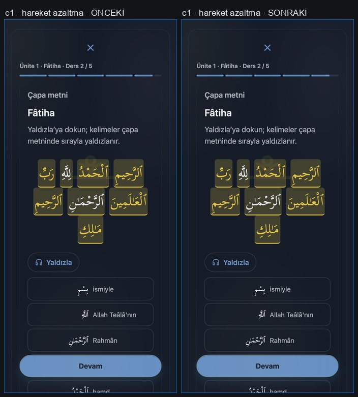

# K3PD-15 — Ders zirvesinde ses–kelime senkronunu ve iptali düzelt

## Durum

- `ready_for_audit` / `NOT_MEASURED`. Bu bir bağımsız kabul hükmü değildir; ajan kendi kabulünü vermedi.
- Branch `k3pd-denetim-duzeltmeleri`, taban HEAD `6fbdf2d3057fe9e4d5dc46e1a13cfb942ae0ad97` (K3PD-14 kapanışı).
- Önkoşul: K3PD-14 `done`; kullanıcı bu oturumda “tam ve kusursuz bi şekilde uygula” diyerek bu kartı açıkça verdi.

## Bulgu (F-06 / K3P-13)

`kaoGild()` ders zirvesinde 9 kelimeyi **sesin gerçek `ended` olayını beklemeden** sabit
`1200/row.length` ms timer ile yaldızlıyordu; ses dizisi deklanmış 1,2 sn'de kesiliyordu.
Ayrıca aktif oturum kimliği yoktu: çıkış, başka ders, yeniden yaldızla ve audio error
durumlarında eski timer / ended / Promise callback'i yeni ekranı değiştirebiliyordu.

Kırmızı kanıt (düzeltme öncesi `HEAD` kodu, yeni testler koşulduğunda):
`test_k3p_lesson_ayah` → `AssertionError: sesli yolda sabit yaldız timer'ı yok` ve
`AssertionError: toplam an > 1,2 sn`; per-assertion koşumda 5 senaryonun **4'ü kırmızı**
(A sesli yol timer, B ended ilerlemesi, D çıkış iptali, E klipsiz satır), 1'i yeşil (C).

## Kaynak sözleşmesi ve düzeltme

İki ayrı sözleşme ayrıldı:

1. **SESLİ yol** — `kaoPlaySequence` (genişletilmiş: `hooks.start/audio/alive`) klipleri
   `ended` ile sırayla çalar. Vurgu klibin **başında** ilerler (`hooks.start`), bir sonraki
   kelime ancak `ended` gelince yaldızlanır. Doğal kayıt süresi hızlandırılmaz, kesilmez;
   1,2 sn varsayımı bu yolda yoktur.
2. **SESSİZ yol** — ses yok/kapalı/hatalı/klipsiz satırda ritmik yedek yürür. 1,2 sn'lik
   DEKORATİF an bütçesi yalnız bu yedeğe uygulanır ve adım **bir kez** hesaplanır
   (her turda yeniden ölçeklenirse bütçe şişiyordu — geliştirme sırasında yakalandı).

Diğer kurallar:

- **Hareket azaltma** yalnız görseli etkiler: satır statik yaldızlanır, timer kurulmaz;
  ses izni varsa ses yine çalar.
- **Klip hizası** yalnız satırın **her** kelimesinde geçerli `w-<lemmaId>-measured` klibi
  varsa kullanılır (`clips.every(Boolean)`). Örnek cümleden kurulan satırlarda (ör. `u04.01`)
  lemma kimliği yoktur → createAudio **0**, dürüst sessiz yedek. Yanlış indeks eşlemesi yok.
- **Tek aktif oturum** — `ui.kaoGildRun` kimliği. `kaoGildStop()` bunu null'lar, timer'ı
  `clearTimer` ile temizler ve çalan sesi `pause()` eder. `alive()` her adımda kimliği
  doğrular, böylece eski ended/timer callback'i yeni turu ilerletmez ve iki ses üst üste binmez.
- `kaoGildStop()` çağrı noktaları: `kaoGild()` başı, ders çıkışı (`action==='exit'`),
  ders adımı etkinleştirme (`kaoLessonActivate`), görünüm değişimi (`kaoApplyView`) ve
  KAO kapanışı (`kaoClose`).
- Ortak ses izni (`kaoAudioEnabled`) ve K3PD-14'te kurulan fail-closed sessiz-saat sözleşmesi
  **değiştirilmedi**.

Yol boyunca aynı dosyadaki dört neredeyse birebir aynı çalma döngüsü (S0, ses bilgisi,
okuyucu, gölgeleme) tek `kaoPlaySequence` üzerine alındı; bu davranışı korur ve bütçeyi
kurtarır (aşağıdaki ölçüm). Böylece runtime tavanı **artırılmadı**.

## Test değişikliği gerekçesi

`tests/kao/test_k3p_lesson_ayah.js`:

- İki eski K3PD-14 iddiası yeni sözleşmeyle çeliştiği için gerekçeli olarak güncellendi:
  izinli hücrede artık `kaoGildTimer` **null** olmalı (ses yolu sabit timer kullanmaz) ve
  `playCalls == createAudioCalls` yerine vurgu-ses bağı aranıyor.
- K3PD-14 testleri korunuyor: 2×2×2 matris (kapalı ayar/sessiz saatte createAudio=0, play=0;
  fail-closed sessiz-saat biçimleri; ses yok/hatalı kiplerde okuma sürer).
- Yeni 7 K3PD-15 kontrolü eklendi (timer yokluğu, ended sırası, hata sonrası yedek, çıkış
  iptali, yeniden yaldızla tek oturum, sızıntı=0, klipsiz satır dürüst yedek).

## Kırmızı → yeşil

| Senaryo | HEAD (eski) | Bu değişiklik |
| --- | --- | --- |
| A sesli yol: ended gelmeden timer ile yaldız | RED | GREEN |
| B ended sırayla ilerletir | RED | GREEN |
| C ses hatası sessiz yedekle tamamlanır | GREEN | GREEN |
| D çıkış eski ended callback'ini iptal eder | RED | GREEN |
| E klipsiz satır dürüst sessiz yedek | RED | GREEN |

`test_k3p_lesson_ayah`: 8 kontrol (K3P-13 + K3PD-14) → **15 kontrol**, exit 0.

## Kart doğrulaması

| Komut | Exit | Ölçüm |
| --- | ---: | --- |
| node tests/kao/test_k3p_lesson_ayah.js | 0 | 15 kontrol; 8 matris hücresi; 7 K3PD-15 senaryosu |
| node tests/kao/test_k3p_lesson_moment.js | 0 | konfeti/palet/≤1,2 sn/reduced-motion/tek tetik |
| node tests/kao/test_k3p_mount.js | 0 | 19 render · 9 ders aşaması · 18 ekran geçişi · yeniden kurulum 0 |
| node tests/kao/test_k3p_resume.js | 0 | 7 kontrol (parça resume, retry, tam ders ödülü) |
| node tests/kao/test_kao_requirements.js | 0 | 524/524 DİA; hedefli 2,3 sn <50 ms |

## G0

| Kontrol | Exit |
| --- | ---: |
| git status/diff --check; HEAD 6fbdf2d3 kaydı | 0 |
| node --check app.js / sync.js / quranLearn.js / quranLearnFlow.js / quranLearnViews.js | 0 (5/5) |
| node .claude/skills/run-seyma/driver.mjs | 0 |
| node .claude/skills/run-seyma/zikr-harness.mjs | 0 (95/95) |
| node kao3-premium/duzeltme-plani/araclar/durum.mjs --check | 0 |
| node tests/kao/test_k3pd_control.js | 0 (33 negatif vaka) |

## G1

`test_kao_migration`, `test_kao2_migration`, `test_kao_fsrs`, `test_kao_queue`,
`test_kao_requirements`, `test_kao_render`, `test_kao2_navigation`, `test_kao2_a11y`,
`test_kao2_inventory`, `test_kao2_design_contract`, `test_kao_pronunciation_contract`,
`test_kao_phonics_contract`, `test_k3p_mount`, `test_k3p_focus_lock`,
`tests/app/test_asset_pin_freshness.js`, `tests/app/test_iip_22.js`,
`tests/kao/test_kao2_perf_budget.js`, `tools/kao/kao-plan-check.mjs`,
`tools/kao/kao-verify-contrast.mjs` → hepsi **exit 0**.

Ölçüm: content 184,591 KiB · runtime **137,229** / 137,25 KiB · CSS 15,922 KiB ·
p95 7,059 ms · steady 3,902 ms (`KAO2_WRITE_BASELINE`/`KAO2_ACCEPT_SLOW_HOST` unset,
taban yazılmadı). Kontrast: 756 çift / 0 alt eşik.

### Bütçe dürüstlüğü (önemli)

- `test_kao2_perf_budget` tabanı **HEAD'de zaten kırmızıydı**: 137,298 KiB > 137,25 KiB
  (K3PD-14 commit'i tavanı 49 B aşmış). Tavan **artırılmadı**.
- Bu kart runtime'ı HEAD'e göre **−69 B** iyileştirdi (140593 → 140524 B), böylece
  `test_kao2_perf_budget` artık **exit 0**.
- Dört kopya çalma döngüsünün tek yola alınması bunun kaynağıdır; yeni özellik kodu
  bütçeyi büyütmedi.
- **Göreli p95 bandı gürültülü:** paralel fixture koşumları sırasında `steady p95` birkaç kez
  bandı aştı (6,6 / 9,5 ms; bir koşuda mutlak `p95 50,3 ms`). Makine boşken arka arkaya üç
  koşum: `19,871 / 7,758 / 8,415 ms` p95 ve `5,925 / 5,023 / 5,004 ms` steady → **üçü de PASS**,
  mutlak tavanlar (137,25 KiB · 40 ms) hep sağlandı. `KAO2_ACCEPT_SLOW_HOST` kullanılmadı,
  taban yazılmadı. Bu dalgalanma ölçüm oynatılarak gizlenmedi; burada açıkça kayıtlıdır.

## Bu oturumda görülen, kapsam dışı (önceden kırmızı) fixture'lar

Aşağıdakiler **HEAD'de de kırmızı**; bu kartın yazma allowlist'i dışında ve bu değişiklikten
etkilenmiyor. Gizlenmiyor, kayda geçiyor:

- `test_kao2_components` (pekiştirme şeridi), `test_kao2_feedback` (aynı konu),
  `test_kao2_curriculum` (index.html 20261019a pin satırı), `test_kao2_kabul`,
  `test_kao2_mastery` (L9 ≤ 137 KiB eşiği — bu kart 137,229'a indirdi, eşik hâlâ aşılıyor).

`tests/kao` tamamı: 83 dosya, 5 kırmızı — beşi de yukarıdaki önceden var olan küme.

## Kapsam ve sınırlar

- Değişen üretim/test yolları: `app/core/quranLearn.js`, `tests/kao/test_k3p_lesson_ayah.js`
  (+ bu kartın durum/kayıt/kanıt yolları).
- Yeni `App.kao*` handler **yok** (45 sabit), şema/`migrate()`/`sync.js`/içerik/font/pin
  değişikliği **yok**, yeni app/core veya app/content modülü **yok**.
- Ses kayıt dosyaları değiştirilmedi/üretilmedi (`assets/kao/audio` salt-okur).
- Ağ, gerçek kullanıcı verisi, token, `seyma-data` ve tarayıcı kullanılmadı; tüm koşumlar
  ağsız sentetik Node/VM.
- Korunan kirli yollar (`kao3-premium/KAPANIS.md`, `README.md`, `kanit/sonraki/GORSEL-KANIT.md`,
  `.pdf`) okunmadı/değiştirilmedi/stage edilmedi.
- Push, merge, tag, deploy **yapılmadı**; `releaseApproval=NOT_APPROVED`;
  `app/core/quranLearn.js` pin borcu K3PD-32'ye kadar ertelenmiş kalır.
- Cihaz, ekran okuyucu, L2, 230 kayıt ve 14/30 günlük öğrenme etkisi dış kapıları `pending`.

---

## Görsel kanıt (kontrollü yerel QA)

Kullanıcı ekran görüntüsü istedi. CLAUDE.md/`run-seyma` “kontrollü yerel görsel QA” istisnası
uygulandı: `tools/kapi/gorsel-qa/cdp.mjs` (CDP pipe, **soket/sunucu yok**), boş geçici profil,
origin yalnız `127.0.0.1:9000`, dış istekler kesik, `forceSync` yok, token yok.
Önce `node tests/app/test_local_visual_qa_guard.js` → **PASS**. Her iki koşumda
`origin: http://127.0.0.1:9000 · token:false · force:null`.

- **Önceki sürüm** = `git archive HEAD~1` (düzeltme öncesi, eski `kaoGildStep`), dizin `/tmp/k3pd15-head`.
- **Sonraki sürüm** = çalışma ağacı (`21378852`).
- Aynı senaryo, aynı 390×844 viewport, aynı 8 kelimelik `u01.02` kapanış satırı.

Dizin: `kanit/K3PD-15/gorsel/`

### Kontak 1 — ses bitmeden yaldız (asıl fark)

Her kare çifti solda ÖNCEKİ, sağda SONRAKİ. Alt sıradaki **2 · t=1850 ms** kritik karedir:
önceki sürümde satırın tamamı altın (ses hiç bitmemişken), yeni sürümde yalnız ilk kelime.

### Kontak 2 — `ended` ilerlemesi + klipsiz satır

Önceki sürümde timer sesin önüne geçiyor (2/8 → 5/8 → 8/8 → 8/8); yeni sürümde her `ended`
tam bir kelime ilerletiyor (1/8 → 2/8 → 3/8 → 4/8). Son iki kare klipsiz satırın iki sürümde
de aynı (23/23) bittiğini gösterir.

### Kontak 3 — hareket azaltma (değişmedi)

### Dosyalar

- `kontak-1-ses-bitmeden-yaldiz.jpg` — asıl fark (0/1/2/3 kareleri, yan yana ÖNCEKİ↔SONRAKİ)
- `kontak-2-ended-ilerleme.jpg` — ended ilerlemesi + klipsiz satır
- `kontak-3-reduced-motion.jpg` — hareket azaltma
- `onceki/log-ONCEKI*.txt`, `sonraki/log-SONRAKI*.txt` — ham ölçüm satırları
- `yeniden-uret-1-ses-bitmeden.mjs`, `yeniden-uret-2-ended-klipsiz-reduced.mjs`, `kontak-olustur.py`
  — kanıtı yeniden üreten betikler (repo kökünden / bu dizinden çalışır)

Ham PNG'ler repoya **alınmadı** (6,5 MB): repo geleneği JPG kontak sayfasıdır (`kao3-premium/kanit/`
önceki kayıtlarla aynı). Betiklerle birebir yeniden üretilebilir; taşınabilirlik doğrulandı
(`yeniden-uret-1…` yeniden koşuldu → aynı ölçümler: 1/8 · 1/8 · 0).

### 1) Asıl fark — ses bitmeden yaldız (sentetik `play()` hiç `ended` üretmez)

| | ÖNCEKİ | SONRAKİ |
| --- | --- | --- |
| `t=350 ms` | **2 / 8** yaldızlı | **1 / 8** |
| `t=1850 ms` | **8 / 8** — tüm satır, ses hiç bitmeden | **1 / 8** — ilk kelimede bekliyor |
| Çıkıştan 1,4 sn sonra | 8/8 (timer satırı bitirmişti) | 0 (ekran kapandı, artık timer yok) |

`ONCEKI-2-sentetik-1850ms.png` (satırın tamamı altın) ↔ `SONRAKI-2-sentetik-1850ms.png`
(yalnız ilk kelime altın) — düzeltmenin görsel kanıtı budur.

### 2) `ended` olayları vurguyu gerçekten ilerletir

Kontrollü klip olaylarıyla, `u01.02`, 8 kelime:

| Adım | ÖNCEKİ | SONRAKİ |
| --- | --- | --- |
| yalnız 1. klip çalıyor (`ended` yok) | 2/8 (timer önden gidiyor) | **1/8** |
| 1. `ended` | 5/8 (3 kelime birden atladı) | **2/8** |
| 2. `ended` | 8/8 (satır bitti, 5 kelime ses çalmadan) | **3/8** |
| 3. `ended` | 8/8 | **4/8** |

Sonraki sürümde her `ended` **tam bir** kelime ilerletiyor; önceki sürümde timer sesin önüne geçiyor.
Görseller: `SONRAKI-a1…a4`, `ONCEKI-a1…a4`.

### 3) Klipsiz satır — dürüst sessiz yedek (`u04.01`, 23 kelime)

| | ÖNCEKİ | SONRAKİ |
| --- | --- | --- |
| `t=1400 ms` | 23/23 | **23/23** |

Davranış kasıtlı olarak aynı: lemma kimliği olmayan satırda ses yolu yok, dekoratif ritmik yedek
1,2 sn'de satırı bitiriyor. Fark, bu yolun artık **ses çalmaya çalışmaması** (test tarafında
`createAudio=0`) ve yanlış indeksle eşleşmemesi. Görsel: `b1-klipsiz-satir.png`.

### 4) Hareket azaltma — statik satır

| | ÖNCEKİ | SONRAKİ |
| --- | --- | --- |
| `t=600 ms` (`SeyFx.shouldAnimate=false`) | 8/8 | **8/8** (statik, timer yok) |

Görsel davranış korundu; sözleşme testi ayrıca timer kurulmadığını doğruluyor.
Görsel: `c1-reduced-motion.png`.

### Sınırlar (dürüstçe)

- Bu **kaynak-görsel kanıttır**, cihaz kabulü değildir. Gerçek iPhone/Safari, gerçek ses
  donanımı, ekran okuyucu ve gerçek kullanıcı verisi kullanılmadı.
- Sentetik `play()` bilinçli olarak hiç bitmez: “ses bitmeden yaldız ilerlemesin” iddiasını
  yalıtmak için. Gerçek kayıtların doğal süresi bu testte ölçülmedi (dosyalara dokunulmadı).
- Ekran görüntüleri redakte edilmiştir: yalnız sentetik onboarding durumu ve ürün içeriği
  görünür; kişisel veri, token, hesap veya konum yok.
- Sunucu açılmadı (CDP pipe), geçici Chrome profilleri `$TMPDIR` altında kaldı; repoya profile
  yazılmadı.
