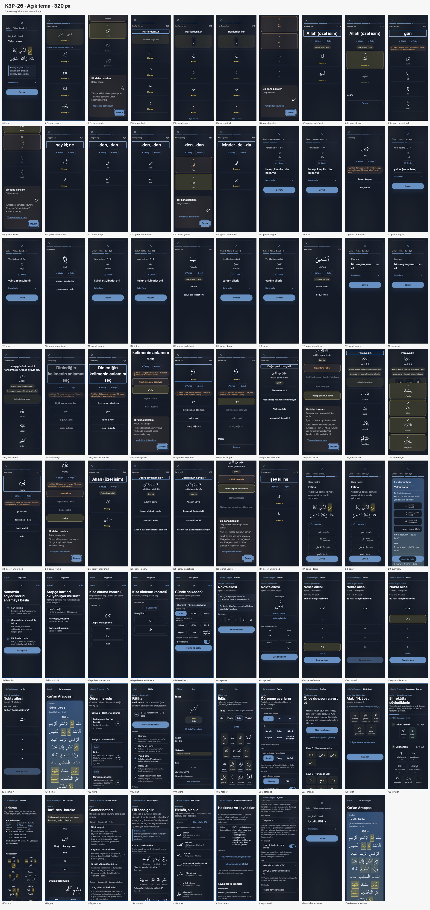
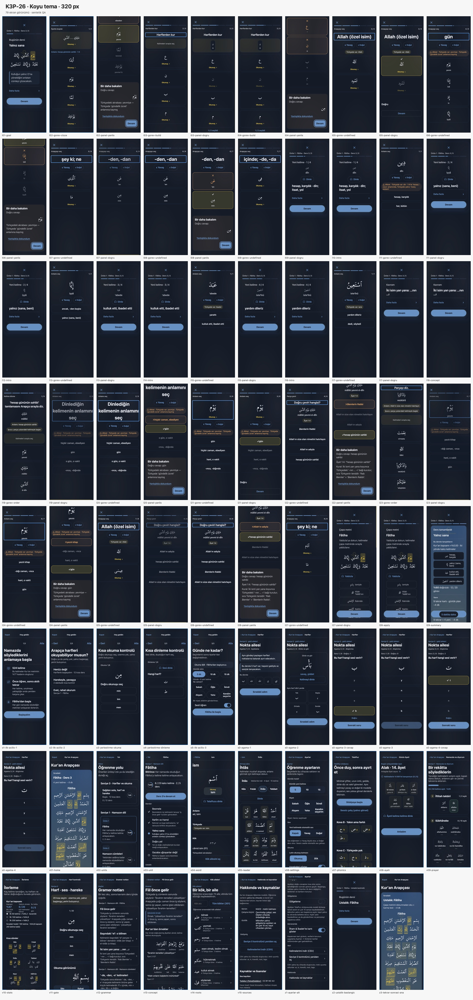
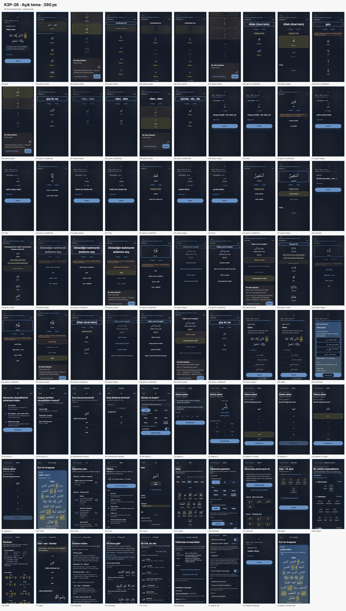
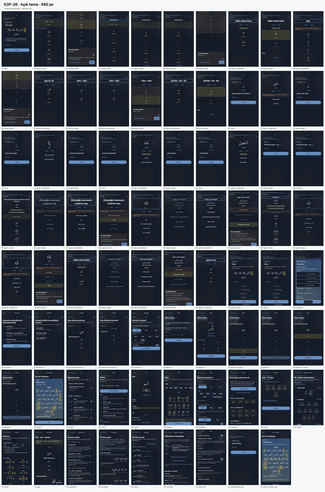
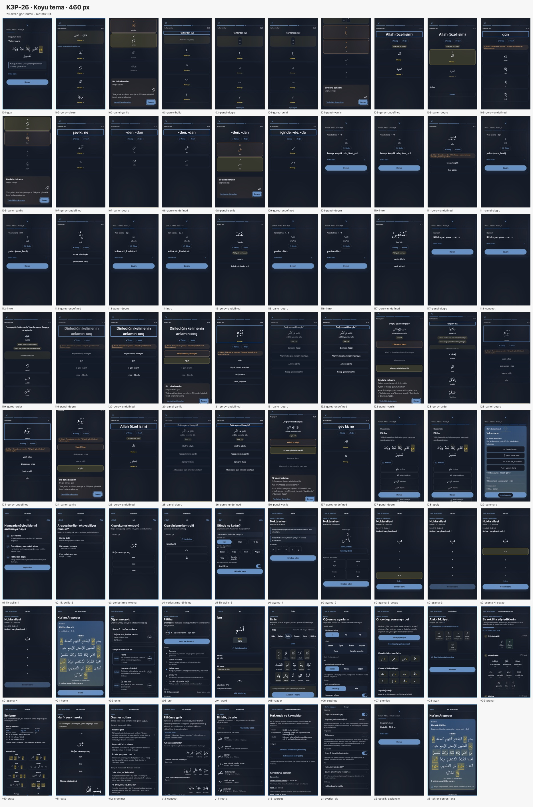

# K3P arayüzü · görsel kanıt rehberi

**Kapsam:** K3P-26 son görsel QA'sında çekilen arayüz; K3P-27 ile `20261018a` pini üzerinden yayımlandı. K3P-27, görünümü oluşturan uygulama kodunu değiştirmedi; ortak `?v=` pinlerini yeniledi. Canlı statik dosyalar yayın sonrası 64/64 SHA-256 eşliğiyle doğrulandı.

**Kanıt türü:** gerçek kullanıcı veya cihaz ekranı değil; `127.0.0.1:9000` üzerinde boş, geçici profillerde oluşturulmuş sentetik arayüz görüntüleridir. Altı görünüm kümesi 320/390/460 px genişlikleri ile açık/koyu temaları kapsar. Her kontakta 79 ekran vardır: 74 ana akış/KAO görünümü ve ayrı ilk açılış profilinden 5 onboarding/yerleştirme görünümü. Toplam **474 ekran**.

## Ekran galerisi

Her küçük resme tıklayarak tam boy kontak sayfasını açabilirsin.

### 320 px

| Açık tema · 79 ekran | Koyu tema · 79 ekran |
| --- | --- |
|  |  |

### 390 px

| Açık tema · 79 ekran | Koyu tema · 79 ekran |
| --- | --- |
|  |  |

### 460 px

| Açık tema · 79 ekran | Koyu tema · 79 ekran |
| --- | --- |
|  |  |

## Görsel tarama bulguları

Altı `issues.txt` dosyasındaki **15 bulgunun tamamı** `KAYDIRMALI-ALAN(bilgi)` sınıfında. Bunlar içerik için yerel yatay kaydırma kullanan bileşenlerdir; diyalog veya sayfanın yatay taşması olarak raporlanmadılar.

| Genişlik | Açık | Koyu | Toplam |
| --- | ---: | ---: | ---: |
| 320 px | 4 | 4 | 8 |
| 390 px | 2 | 3 | 5 |
| 460 px | 1 | 1 | 2 |
| **Toplam** | **7** | **8** | **15** |

Bulgu türleri:

- **6 sûre seçicisi** (`.kao-surah-picker`): uzun sûre adları kendi seçicisinde kaydırılır.
- **2 gramer tablosu** (`.kao-grammar-table-wrap`): yalnız 320 px kontrollerinde görüldü.
- **7 ders tablosu** (`.kao-lesson-table-wrap`): ders açıklama/alıştırma tabloları içinde görüldü.

### Ham kayıtların dökümü

`sw/cw`, öğenin `scrollWidth/clientWidth` değeridir. Bu fark, yalnız aşağıdaki bileşen içindeki yatay kaydırma alanını gösterir.

| Tema / genişlik | Ekran ve bileşen | `sw/cw` |
| --- | --- | ---: |
| Açık · 320 px | `v05-reader` · `.kao-surah-picker` | 1519/296 |
| Açık · 320 px | `v13-concept` · `.kao-grammar-table-wrap` | 345/294 |
| Açık · 320 px | `l17-panel-dogru`, `l18-concept` · `.kao-lesson-table-wrap` | 289/220 (her biri) |
| Koyu · 320 px | `v05-reader` · `.kao-surah-picker` | 1519/296 |
| Koyu · 320 px | `v13-concept` · `.kao-grammar-table-wrap` | 345/294 |
| Koyu · 320 px | `l17-panel-dogru`, `l18-concept` · `.kao-lesson-table-wrap` | 289/220 (her biri) |
| Açık · 390 px | `v05-reader` · `.kao-surah-picker` | 1519/358 |
| Açık · 390 px | `l18-concept` · `.kao-lesson-table-wrap` | 289/282 |
| Koyu · 390 px | `v05-reader` · `.kao-surah-picker` | 1519/358 |
| Koyu · 390 px | `l17-panel-dogru`, `l18-concept` · `.kao-lesson-table-wrap` | 289/282 (her biri) |
| Açık · 460 px | `v05-reader` · `.kao-surah-picker` | 1519/428 |
| Koyu · 460 px | `v05-reader` · `.kao-surah-picker` | 1519/428 |

Altı ana `log.txt` dosyasının her birinde **74/74** kayıtlı görünüm için `overflowX=false`. Her kontakta yer alan beş ilk açılış/yerleştirme görünümü ayrıca tarandı; `issues.txt` içinde taşma veya kırpılma bulgusu üretmedi. Beklenmeyen `DIŞARI-TAŞAR`, `METİN-KUTUDAN-TAŞAR`, kırpılma veya sayfa taşması bulgusu yok.

## Güvenlik ve doğrulama izi

- Altı ana oturumun `log.txt` kaydı: `origin: http://127.0.0.1:9000 token:false force:null`, `blocked-external: 42`.
- Onboarding görüntüleri ayrı geçici profillerde alındı; `shoot-modal.mjs` her profil için dış istekleri engelleyen CDP oturumu kurar.
- Görsel QA Guard 1 testi 10/10 PASS idi. `forceSync=1` ve `seyma-sync-force` kullanılmadı; `mustafaras/seyma-data`'ya erişilmedi.
- Her genişlik/tema için ham görüntüler kontaklar üretildikten sonra kaldırıldı. Altı kontak, altı `log.txt`, altı `issues.txt` ve [K3P-00 karşılaştırması](K3P-00-K3P-26-KARSILASTIRMA.html) korunuyor.
- Bu kanıt sentetik yerel QA'dır. Cihaz kabulü, gerçek ekran okuyucu, L2 uzman incelemesi ve kullanıcı verisi ölçümü değildir.

## Kaynaklar

- [Program kapanışı ve kabul sınırları](../../KAPANIS.md)
- [K3P-26 görsel QA devir notu](../../DEVIR-K3P-26-CODEX-LUNA.md)
- [320 px açık tema bulguları](acik-320/issues.txt) · [390 px açık tema bulguları](acik-390/issues.txt) · [460 px açık tema bulguları](acik-460/issues.txt)
- [320 px koyu tema bulguları](koyu-320/issues.txt) · [390 px koyu tema bulguları](koyu-390/issues.txt) · [460 px koyu tema bulguları](koyu-460/issues.txt)
